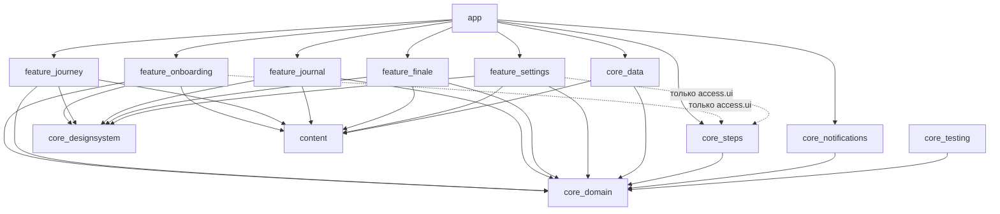
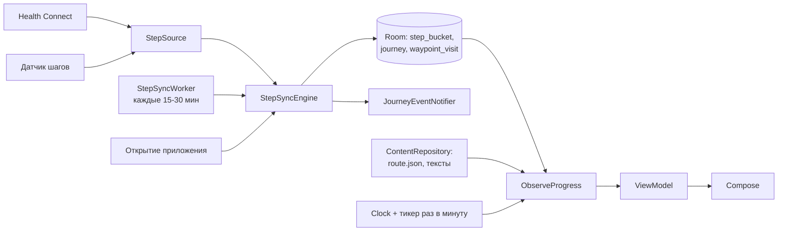
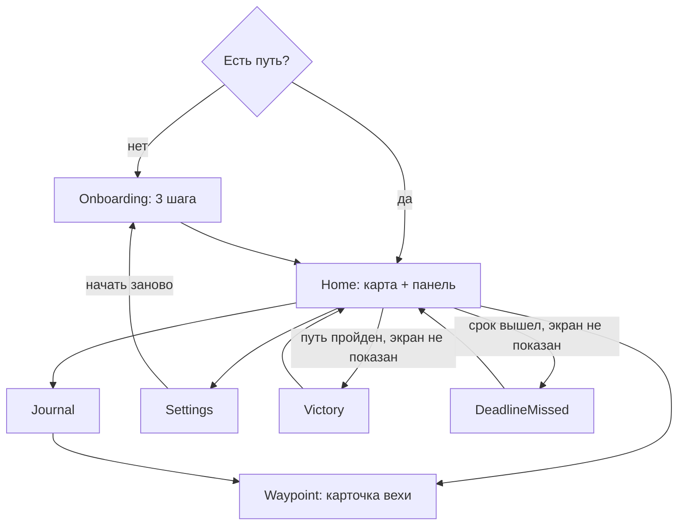

# Архитектура

Офлайн Android-приложение без сервера и без доступа в интернет. Шаги читаются из Health Connect или встроенного датчика, складываются в локальную базу по часам, из них чистыми функциями считается положение на маршруте, план и статус.

Связанные документы:

- [data.md](data.md): база, настройки, форматы файлов контента;
- [steps.md](steps.md): источники шагов, синхронизация, разрешения;
- [map.md](map.md): карта, тайлы, слои поверх карты;
- [content-pack.md](content-pack.md): модуль контента, контракт на картинки и тексты;
- [decisions.md](decisions.md): принятые решения (ADR) и почему.

## Стек

| Что | Чем | Примечание |
|---|---|---|
| Язык | Kotlin 2.x | JDK toolchain 17 |
| UI | Jetpack Compose, Material 3 | только светлая тема (ADR-011) |
| Архитектура UI | MVVM + однонаправленный поток данных | `UiState` + события, `StateFlow` |
| DI | Hilt (KSP) | плюс `hilt-work` для воркеров |
| База | Room (KSP) | схемы экспортируются в репозиторий |
| Настройки | DataStore Preferences | |
| Фон | WorkManager | без foreground service |
| Шаги | Health Connect (`androidx.health.connect:connect-client`), датчик `TYPE_STEP_COUNTER` | ADR-004 |
| Карта | MapCompose (`ovh.plrapps:mapcompose`) | подтверждается спайком T-301, запасной вариант Telephoto (ADR-007) |
| Картинки | Coil 3 без сетевого модуля | грузит из `assets` |
| JSON | kotlinx.serialization | |
| Навигация | Navigation Compose с типобезопасными маршрутами | |
| Время | `java.time` + внедряемый `Clock` | |
| Тесты | JUnit 4, kotlinx-coroutines-test, Turbine, Robolectric, Roborazzi | без эмулятора, ADR-012 |
| Стиль и проверки | Spotless + ktlint, Android Lint | |
| CI | GitHub Actions | |

Версии: последние стабильные на момент T-001, все в `gradle/libs.versions.toml`. Обновление версий отдельным PR.

SDK: `minSdk 28` (Android 9, минимальная версия, где работает Health Connect), `compileSdk` и `targetSdk` не ниже требования Google Play на момент релиза (осень 2026: API 36, проверить в T-503).

## Модули

```
app/                     точка входа, NavHost, связывание DI, манифест
core/domain/             чистый Kotlin (JVM): модели, правила игры, интерфейсы репозиториев
core/data/               Room, DataStore, реализации репозиториев, загрузка контента
core/steps/              источники шагов (Health Connect, датчик), движок синхронизации, воркер
core/notifications/      каналы и уведомления
core/designsystem/       тема, цвета, шрифты, общие компоненты, пергамент
core/testing/            фейки репозиториев и источников, тестовые часы, тестовый маршрут
content/                 всё про Средиземье: route.json, тексты, карта, картинки, название приложения
feature/onboarding/      знакомство, выбор срока, доступ к шагам
feature/journey/         главный экран: карта и панель прогресса
feature/journal/         журнал вех и карточка вехи
feature/finale/          победа, срок вышел, продление
feature/settings/        настройки
build-logic/             convention-плагины Gradle
tools/map-tiles/         скрипт нарезки карты на тайлы
tools/route-editor/      HTML-редактор координат маршрута
scripts/                 установка Android SDK, проверки для CI
```

В v1.1 добавятся `feature/achievements/` и `widget/`.

Пакет: `io.github.m0peterson.longwalk.<модуль>`, например `...core.domain`, `...feature.journey` (решение D-2 в PRD).

### Правила зависимостей



- `:core:domain` не зависит ни от чего, кроме `kotlinx-coroutines-core` и `javax.inject`. Никакого Android. Это проверяется тем, что модуль собран плагином `kotlin("jvm")`.
- Фичи не зависят от `:core:data`, `:core:steps` и друг от друга. Они видят только интерфейсы из домена. Реализации подставляет Hilt в `:app`.
- Одно исключение: `:feature:onboarding` и `:feature:settings` зависят от `:core:steps`, но используют только пакет `...core.steps.access.ui`: composable-хелперы запуска диалогов разрешений и интенты установки Health Connect. Логику доступа ViewModel берёт через интерфейс `StepAccess` из домена.
- `:content` не содержит логики. Только файлы и объект `ContentPaths` с путями к экранным картинкам.
- Названия мест, имена и цитаты встречаются только в `:content`. В коде остальных модулей их нет (ADR-006).
- Новая зависимость между модулями, которой нет на схеме, требует правки этого файла в том же PR.

## Поток данных



1. Синхронизация (`StepSyncEngine`) забирает шаги из активного источника и пишет часовые корзины в Room. Потом считает, какие вехи пересечены, пишет их в журнал и зовёт уведомления.
2. `ObserveProgress` (домен) объединяет путь, сумму шагов, маршрут и текущее время и отдаёт `JourneyProgress`. Его используют главный экран, финальные экраны, уведомления, позже виджет.
3. ViewModel превращает `JourneyProgress` в `UiState` конкретного экрана. Никакой игровой логики во ViewModel и в UI: только форматирование.

## Контракты

Это сигнатуры, о которых договариваются параллельные задачи. Реализация пишется в задачах. Детали (имена параметров, дополнительные поля) можно уточнять, смысл нельзя без правки этого файла.

### Домен: модели

```kotlin
data class MapPoint(val x: Double, val y: Double)          // доли 0..1 от левого верхнего угла карты

enum class WaypointKind { MAJOR, MINOR }

data class Waypoint(
    val id: String,                 // "rivendell"
    val kind: WaypointKind,
    val number: Int?,               // 1..23 у MAJOR, null у MINOR
    val km: Double,                 // км маршрута от старта
    val point: MapPoint,
    val illustration: String?,      // путь в assets, null если картинки нет
)

data class Route(
    val id: String,
    val lengthKm: Double,
    val waypoints: List<Waypoint>,   // по возрастанию km, первая с km = 0
    val legs: List<List<MapPoint>>,  // legs[i]: ломаная от waypoints[i] до waypoints[i+1], концы включены
    val mapAspect: Double,           // ширина / высота карты в пикселях
)

enum class JourneyState { ACTIVE, COMPLETED, ABANDONED }

data class Journey(
    val id: Long,
    val routeId: String,
    val startedAt: Instant,          // начало локального дня старта
    val startDate: LocalDate,
    val deadline: LocalDate,         // включительно
    val originalDeadline: LocalDate,
    val planAnchorAt: Instant,       // при старте момент нажатия «В путь!», потом момент последней смены срока
    val planAnchorSteps: Long,
    val strideMeters: Double,
    val routeScale: Double,          // 1.0 в MVP
    val state: JourneyState,
    val completedAt: Instant?,
    val victorySeen: Boolean,
    val missedNoticeFor: LocalDate?, // для какого срока уже показан экран «срок вышел»
)

data class StepBucket(val hourStart: Instant, val steps: Long)

data class WaypointVisit(val journeyId: Long, val waypointId: String, val reachedAt: Instant, val seen: Boolean)

enum class StepSourceType { HEALTH_CONNECT, SENSOR }
enum class JourneyPhase { IN_PROGRESS, DEADLINE_MISSED, COMPLETED }
enum class PaceStatus { ON_TRACK, AHEAD, BEHIND }
enum class Pose { ON_TRACK, AHEAD, BEHIND, REST }

data class JourneyProgress(
    val phase: JourneyPhase,
    val walkedKm: Double,            // реальные км
    val totalKm: Double,             // реальные км
    val fraction: Double,            // 0..1
    val position: MapPoint,
    val lastReached: Waypoint,
    val next: Waypoint?,
    val kmToNext: Double?,           // реальные км
    val todaySteps: Long,
    val todayTargetSteps: Long?,
    val dailyPlanSteps: Long,
    val deltaDays: Double?,
    val status: PaceStatus?,         // null вне IN_PROGRESS
    val pose: Pose?,                 // null после победы
    val daysLeft: Long,
    val etaDate: LocalDate?,
)
```

### Домен: интерфейсы данных

```kotlin
interface ContentRepository {
    suspend fun route(): Route
    suspend fun texts(locale: Locale): RouteTexts      // с откатом на английский
}

data class WaypointText(val title: String, val place: String?, val season: String?, val story: String?)
data class ScreenText(val title: String, val body: String?)

data class RouteTexts(
    val appTitle: String,
    val routeTitle: String,
    val disclaimer: String,
    val canonPaceLabel: String,                 // подпись пресета «как в книге»
    val waypoints: Map<String, WaypointText>,
    val screens: Map<String, ScreenText>,       // ключи в data.md
)

interface JourneyRepository {
    fun observeCurrent(): Flow<Journey?>               // активный, иначе последний завершённый
    suspend fun start(deadline: LocalDate, strideMeters: Double, routeScale: Double): Journey
    suspend fun changeDeadline(id: Long, deadline: LocalDate, anchorAt: Instant, anchorSteps: Long)
    suspend fun updateStride(id: Long, strideMeters: Double)
    suspend fun complete(id: Long, at: Instant)
    suspend fun abandon(id: Long)
    suspend fun markVictorySeen(id: Long)
    suspend fun markMissedNoticeSeen(id: Long, deadline: LocalDate)
    fun observeVisits(id: Long): Flow<List<WaypointVisit>>
    suspend fun addVisits(id: Long, visits: List<Pair<String, Instant>>)
    suspend fun markSeen(id: Long, waypointIds: List<String>)
}

interface StepRepository {
    fun observeSum(from: Instant, to: Instant): Flow<Long>
    fun observeBuckets(from: Instant, to: Instant): Flow<List<StepBucket>>
    suspend fun sum(from: Instant, to: Instant): Long
    suspend fun buckets(from: Instant, to: Instant): List<StepBucket>
    suspend fun replaceRange(from: Instant, to: Instant, buckets: List<StepBucket>, source: StepSourceType)
    suspend fun add(hourStart: Instant, steps: Long, source: StepSourceType)
}

interface SettingsRepository {
    val settings: Flow<AppSettings>
    suspend fun update(transform: (AppSettings) -> AppSettings)
}

interface JourneyEventNotifier {
    suspend fun onWaypointsReached(journey: Journey, waypoints: List<Waypoint>)
    suspend fun onJourneyCompleted(journey: Journey)
}

interface Ticker { fun everyMinute(): Flow<Instant> }
```

`AppSettings` описан в [data.md](data.md).

### Домен: логика

| Класс | Что делает | Задача |
|---|---|---|
| `RouteGeometry` | длины ломаных, точка на маршруте по км, пройденная и оставшаяся часть линии | T-101 |
| `RouteValidator` | проверка маршрута по правилам из data.md | T-101 |
| `JourneyCalculator` | всё из разделов 2-5 и 7 правил игры: план, статус, поза, норма, прогноз, пресеты и проверка срока | T-102 |
| `WaypointDetector` | какие вехи пересечены и в какой момент, по часовым корзинам | T-102 |
| `ObserveProgress` | поток `ProgressSnapshot(journey, route, progress, visits)` из репозиториев, часов и тикера | T-102 |

### Домен: доступ к шагам и синхронизация

Эти типы в домене, потому что их используют ViewModel фич.

```kotlin
enum class Availability { AVAILABLE, NEEDS_INSTALL, NEEDS_UPDATE, UNSUPPORTED }
enum class StepFailure { NO_SOURCE, PERMISSION_LOST, UNAVAILABLE, RATE_LIMITED, TEMPORARY }

data class StepSourceStatus(
    val availability: Availability,
    val permissionGranted: Boolean,
    val backgroundRead: Boolean,     // можно ли читать, когда приложение закрыто
)

interface StepAccess {
    suspend fun status(type: StepSourceType): StepSourceStatus
    suspend fun recommendedSource(): StepSourceType?    // Health Connect, если доступен, иначе датчик, иначе null
    fun deviceCountsStepsItself(): Boolean              // Android 14+ и SDK Extension 20+
    suspend fun activate(type: StepSourceType)          // step_source, source_since, перепланировать воркер
}

enum class SyncTrigger { ONBOARDING, APP_START, APP_RESUME, MANUAL, PERIODIC, BOOT, TIME_CHANGED }
data class SyncResult(val newVisits: List<Waypoint>, val completed: Boolean, val failure: StepFailure?)

interface StepSync { suspend fun sync(trigger: SyncTrigger): SyncResult }
```

### Шаги (`:core:steps`)

```kotlin
interface StepSource {
    val type: StepSourceType
    suspend fun status(): StepSourceStatus
    suspend fun collect(from: Instant, to: Instant): StepCollection
}

sealed interface StepCollection {
    data class Absolute(val buckets: List<StepBucket>) : StepCollection     // заменить корзины в диапазоне
    data class Delta(val hourStart: Instant, val steps: Long) : StepCollection
    data class Failed(val reason: StepFailure) : StepCollection
}

class StepSyncEngine(/* источники через Hilt-мультибиндинг Map<StepSourceType, StepSource> */) : StepSync
```

Источники регистрируются через `@IntoMap`, каждый в своём Hilt-модуле, поэтому T-201 и T-203 не правят один файл. Подробно в [steps.md](steps.md).

## Навигация



- Маршруты: `OnboardingRoute`, `HomeRoute`, `WaypointRoute(id, fromQueue)`, `JournalRoute`, `SettingsRoute(section: SettingsSection? = null)`, `VictoryRoute`, `DeadlineMissedRoute`. `SettingsSection`: `JOURNEY`, `STEPS`, `NOTIFICATIONS`, `ABOUT`; с ним настройки открываются прокрученными к разделу.
- Каждая фича отдаёт функцию-расширение `NavGraphBuilder.xxxScreen(...)`, `:app` собирает граф. T-001 создаёт граф со всеми маршрутами и заглушками, фичи заменяют только свою заглушку.
- Очередь непросмотренных вех и показ финальных экранов решает `HomeViewModel`: он отдаёт событие навигации, экран переходит.
- Уведомление о вехе открывает `MainActivity` с аргументом и ведёт на `WaypointRoute`.

## Фоновая работа

- `StepSyncWorker`: периодический `CoroutineWorker`, уникальное имя, 30 минут для Health Connect, 15 минут для датчика. Ограничений нет, WorkManager сам учитывает Doze.
- Синхронизация ещё и при: старте приложения, возврате на передний план (`ProcessLifecycleOwner`), ручном обновлении, загрузке телефона, смене часового пояса или времени.
- Foreground service не используем: аппаратный счётчик копит шаги сам, а Health Connect хранит их за нас (ADR-005).
- Одновременно идёт только одна синхронизация (`Mutex` в движке).

## Время

- `java.time.Clock` внедряется через Hilt. Вызывать `Instant.now()`, `LocalDate.now()`, `System.currentTimeMillis()` напрямую запрещено везде, кроме модуля, который предоставляет `Clock`.
- Часовой пояс: `clock.zone`, в проде `Clock.systemDefaultZone()`, пересоздаётся при `ACTION_TIMEZONE_CHANGED`.
- `Ticker` раз в минуту, чтобы план и «сегодня» обновлялись на открытом экране и в полночь.

## Ошибки

- Источник шагов не отвечает: последние данные остаются, на главном экране плашка «шаги обновлены N мин назад» и кнопка повтора.
- Разрешение отозвано: плашка «нет доступа к шагам» с кнопкой «Выдать».
- Битый `route.json`: падение при сборке тестов, а не у пользователя (T-103 проверяет реальный файл в тестах).
- Исключения в воркере логируются и не роняют процесс. `Result.retry()` только для временных ошибок.

## Локализация

- Интерфейс: `values/strings.xml` (английский, запасной) и `values-ru/strings.xml` (русский) в каждом модуле.
- Контент: `content/src/main/assets/texts/en.json` и `ru.json` (формат в [data.md](data.md)).
- Числа и даты форматируются по локали (`NumberFormat`, `DateTimeFormatter.ofLocalizedDate`).
- Склонения через `plurals`.

## Тестирование

| Уровень | Где | Чем | Что обязательно |
|---|---|---|---|
| Правила игры | `:core:domain` | JUnit на JVM | каждая строка из game-rules.md, включая пограничные случаи |
| Данные | `:core:data`, `:core:steps` | Robolectric, Room in-memory, фейк Health Connect | запись, чтение, миграции, движок синхронизации |
| ViewModel | фичи | фейки из `:core:testing`, Turbine | каждое состояние экрана |
| Экраны | фичи, designsystem | Roborazzi (скриншоты на Robolectric) | каждое состояние из ТЗ задачи, ru и en |
| Руками | телефон владельца | | сценарии из раздела «Ручная проверка» каждой задачи |

Фейки вместо моков. MockK не используем: фейки из `:core:testing` переиспользуются всеми.

## Бюджеты

| Что | Бюджет |
|---|---|
| Размер загрузки из Google Play | до 60 МБ (тайлы карты ~20-30 МБ) |
| Холодный старт | до 1,5 с на телефоне среднего класса |
| Карта | без видимых рывков при прокрутке и зуме |
| Батарея | до 1% в сутки |
| Память | карта не держит в памяти больше видимых тайлов плюс кэш |

## Приватность

- Разрешения `INTERNET` в итоговом манифесте нет. CI падает, если оно появилось (T-002).
- Данные о шагах не покидают телефон, кроме системной резервной копии Android (T-502).
- Состояние датчика шагов (последнее значение счётчика) в резервную копию не попадает: на другом телефоне оно бессмысленно.
