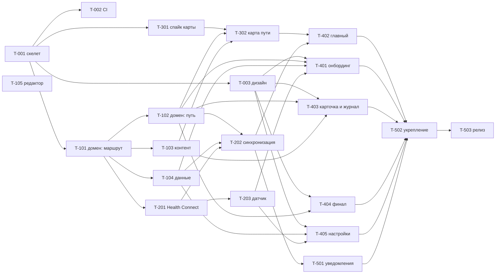

# Роадмап

Два параллельных трека:

- **Трек A (владелец):** картинки по промптам, финальная карта, координаты маршрута, вычитка текстов, юридическое решение, Google Play, проверка на телефонах.
- **Трек B (агенты):** код по задачам из [docs/tasks/](tasks/README.md).

Код не ждёт картинок: всё работает на заглушках (см. [content-pack.md](architecture/content-pack.md)). Картинки не ждут кода: их можно генерировать уже сейчас.

## Этапы

| Этап | Цель | Задачи | Готово, когда |
|---|---|---|---|
| **M0. Фундамент** | проект собирается, CI проверяет каждый PR, есть тема | T-001, T-002, T-003 | пустое приложение с пергаментным экраном ставится на телефон, CI зелёный |
| **M1. Домен и контент** | правила игры и маршрут в коде, база | T-101, T-102, T-103, T-104, T-105 | все правила из game-rules.md покрыты тестами, реальный `route.json` проходит проверку |
| **M2. Шаги** | шаги реально приходят и пишутся в базу | T-201, T-202, T-203 | на телефоне владельца сутки шагов из Health Connect и с датчика совпадают с трекером ±2% |
| **M3. Карта** | карта с маршрутом и хоббитами | T-301, T-302 | заглушка карты 6144×6144 листается без рывков, хоббиты стоят там, где должны |
| **M4. Экраны MVP** | весь путь пользователя от установки до победы | T-401, T-402, T-403, T-404, T-405 | все истории US-1..US-10 из PRD проходятся руками |
| **M5. Релиз** | готово к закрытому тестированию | T-501, T-502, T-503 | AAB во внутреннем тестировании Google Play или APK у тестировщиков |
| **v1.1** | удержание | T-601, T-602, T-603, T-604 | по итогам закрытого теста |

## Когда MVP готов к закрытому тесту

Все пункты, без исключений:

1. Истории US-1..US-12 из PRD проходятся руками на телефоне владельца.
2. Качество из раздела «Метрики» PRD держится 7 дней подряд на двух телефонах (Android 14+ и Android 13 или ниже): расхождение шагов до 2%, батарея до 1% в сутки, ни одного падения.
3. Весь арт приоритета A на месте, координаты сняты с финальной карты.
4. Тексты вех вычитаны владельцем.
5. Решения D-1, D-3, D-4 приняты.
6. CI зелёный на `main`, release-сборка собирается.

## Задачи

Размер: **S** до половины дня работы агента, **M** около дня, **L** больше дня (такие режутся при необходимости).

| ID | Задача | Этап | Модули | Зависит от | Размер |
|---|---|---|---|---|---|
| [T-001](tasks/T-001-project-skeleton.md) | Скелет проекта и модули | M0 | все | | M |
| [T-002](tasks/T-002-ci-and-quality.md) | CI и проверки качества | M0 | корень, `.github` | T-001 | S |
| [T-003](tasks/T-003-design-system.md) | Дизайн-система | M0 | `:core:designsystem` | T-001 | M |
| [T-101](tasks/T-101-domain-route.md) | Домен: модели, интерфейсы, геометрия маршрута | M1 | `:core:domain`, `:core:testing` | T-001 | M |
| [T-102](tasks/T-102-domain-journey.md) | Домен: план, статус, вехи, прогресс | M1 | `:core:domain`, `:core:testing` | T-101 | L |
| [T-103](tasks/T-103-content-and-route.md) | Контент: маршрут, тексты, загрузка | M1 | `:content`, `:core:data` | T-101 | L |
| [T-104](tasks/T-104-data-layer.md) | Данные: Room, DataStore, репозитории | M1 | `:core:data` | T-101 | M |
| [T-105](tasks/T-105-route-editor.md) | Редактор координат маршрута (HTML) | M1 | `tools/route-editor` | | S |
| [T-201](tasks/T-201-health-connect.md) | Источник шагов Health Connect | M2 | `:core:steps`, `:app` | T-101 | M |
| [T-202](tasks/T-202-sync-engine.md) | Движок синхронизации и воркер | M2 | `:core:steps`, `:app` | T-102, T-104, T-201 | L |
| [T-203](tasks/T-203-sensor-source.md) | Источник шагов: датчик | M2 | `:core:steps` | T-201 | M |
| [T-301](tasks/T-301-map-spike.md) | Спайк карты и нарезка тайлов | M3 | `tools/map-tiles`, `:content`, `:feature:journey` | T-001 | M |
| [T-302](tasks/T-302-journey-map.md) | Карта пути: маршрут, вехи, хоббиты | M3 | `:feature:journey` | T-301, T-102, T-103 | L |
| [T-401](tasks/T-401-onboarding.md) | Онбординг | M4 | `:feature:onboarding` | T-003, T-102, T-104, T-201, T-203 | L |
| [T-402](tasks/T-402-home.md) | Главный экран | M4 | `:feature:journey` | T-302, T-202 | L |
| [T-403](tasks/T-403-waypoint-card-and-journal.md) | Карточка вехи и журнал | M4 | `:feature:journal` | T-003, T-102, T-103 | M |
| [T-404](tasks/T-404-finale.md) | Победа, срок вышел, продление | M4 | `:feature:finale` | T-003, T-102 | M |
| [T-405](tasks/T-405-settings.md) | Настройки | M4 | `:feature:settings`, `:app` | T-003, T-104, T-203 | M |
| [T-501](tasks/T-501-notifications.md) | Уведомления и напоминания | M5 | `:core:notifications`, `:app` | T-202 | M |
| [T-502](tasks/T-502-hardening.md) | Резервная копия, пограничные случаи, release-сборка | M5 | несколько | M4 | M |
| [T-503](tasks/T-503-release-prep.md) | Подготовка к публикации | M5 | `:app`, `docs/legal`, `fastlane` | T-502 | M |
| [T-601](tasks/T-601-widget.md) | Виджет | v1.1 | `:widget` | M5 | M |
| [T-602](tasks/T-602-achievements.md) | Достижения | v1.1 | `:core:domain`, `:core:data`, `:feature:achievements` | M5 | L |
| [T-603](tasks/T-603-route-scale.md) | Сокращённый маршрут | v1.1 | `:feature:onboarding`, `:feature:settings` | M5 | S |
| [T-604](tasks/T-604-share-card.md) | Карточка «поделиться» | v1.1 | `:feature:journey` | M5 | M |

## Граф зависимостей

## Волны

Что можно отдавать агентам одновременно. Внутри волны задачи работают в разных модулях. Пересечения мелкие и известные: T-202 и T-203 оба дописывают ресиверы в манифест `:core:steps`, задачи волны 4 передают лямбды навигации в `NavHost` в `:app`. Такие конфликты решает тот PR, который мёржится вторым, подтянув `main`.

| Волна | Задачи | Сколько агентов |
|---|---|---|
| 0 | T-001 | 1 |
| 1 | T-002, T-003, T-101, T-301, T-105 | до 5 |
| 2 | T-102, T-103, T-104, T-201 | до 4 |
| 3 | T-202, T-203, T-302, T-403, T-404 | до 5 |
| 4 | T-401, T-402, T-405, T-501 | до 4 |
| 5 | T-502 | 1 |
| 6 | T-503 | 1 |

Узкое место не агенты, а ревью владельца. Реалистично 2-4 PR в день. Больше волны в 3 агента имеет смысл, только если на ревью есть время.

## Сроки

Оценка, а не обещание. Исходит из того, что владелец ревьюит каждый PR в течение дня и проверяет руками то, что просит задача.

| Этап | Календарных дней |
|---|---|
| M0 | 2-3 |
| M1 (параллельно со спайком карты) | 3-5 |
| M2 | 3-5 |
| M3 | 3-5 |
| M4 | 5-8 |
| M5 | 3-5 |
| **Итого до закрытого теста** | **4-6 недель** |
| Закрытый тест в Google Play | ещё минимум 14 дней (см. T-503) |

Что сдвинет сроки сильнее всего: спайк карты (если MapCompose не подойдёт, +3-5 дней), Health Connect на конкретных телефонах тестировщиков, проверка Google Play на доступ к Health Connect.

## Трек A: задачи владельца

| ID | Что | Когда | Блокирует |
|---|---|---|---|
| A-1 | Эталон стиля (`locations/01-bag-end.md`) и лист персонажей | сейчас | весь арт |
| A-2 | Финальная карта, мастер от 6144×6144 | до конца M3 желательно | A-3 |
| A-3 | Снять координаты 51 вехи и промежуточные точки с финальной карты редактором T-105 | после A-2 и T-105 | релиз |
| A-4 | Остальной арт приоритета A (22 позиции) | до M5 | релиз |
| A-5 | Вычитать тексты вех на русском | после T-103 | релиз |
| A-6 | Решения D-1..D-6 из PRD. D-2 (applicationId) до T-001 | D-2 сразу, остальное до M5 | T-001, T-503 |
| A-7 | Аккаунт разработчика Google Play, хостинг политики конфиденциальности (GitHub Pages), набор тестировщиков | до M5 | T-503 |
| A-8 | Ручные проверки из PR на своих телефонах. Минимум: Android 14+, Android 13 или ниже, Samsung или Xiaomi | на каждом этапе | приёмка этапа |
| A-9 | Поставить Lord of the Steps и посмотреть, есть ли у них срок и график. Час работы, экономит недели | до M4 | понимание, чем отличаемся |
| A-10 | Окружение для агентов: Android SDK и доступ в сеть к `dl.google.com`, `maven.google.com`, `repo.maven.apache.org`, `plugins.gradle.org`, `services.gradle.org` | до T-001 | всё |

## Риски

| Риск | Вероятность | Ущерб | Что делаем |
|---|---|---|---|
| Приложение с названиями Средиземья снимут из Google Play по жалобе | высокая при публикации | высокий | контент-пакет (ADR-006), решение D-1 до M5 |
| Прямые конкуренты: лицензированный The Conqueror, бесплатный Lord of the Steps | факт | средний | упор на срок и график, арт, офлайн. A-9 |
| У пользователя нет данных о шагах (нет трекера, Android 9-13) | средняя | высокий | датчик (T-203), подсказки в онбординге, плашка «за сутки ни одного шага» |
| Производитель убивает фоновые задачи | высокая на Xiaomi и Huawei | средний | шаги подтягиваются при открытии, без foreground service |
| Карта тормозит или весит слишком много | средняя | высокий | спайк в первой волне, бюджет 60 МБ, запасная библиотека |
| Апскейл карты заметен при зуме | высокая | низкий | ограничение максимального зума |
| Стиль картинок разъедется между генерациями | средняя | средний | эталон стиля, один генератор, приложение работает без картинок B |
| Пользователь выбирает непосильный срок и бросает | высокая | высокий | шаги в день рядом с пресетом, по умолчанию 12 месяцев, запрет больше 40 000 в день, продление без наказания |
| Долгие участки без событий | была высокой | средний | малые вехи, разрыв не больше 100 км |
| Google Play долго проверяет доступ к Health Connect | средняя | средний | декларация и политика готовятся в T-503 заранее |
| Код от разных агентов расползается по стилю и архитектуре | средняя | средний | AGENTS.md, CI, маленькие задачи, ревью |
| Расстояния неточные | факт | низкий | честно сказано, цифры в данных и правятся без кода |
